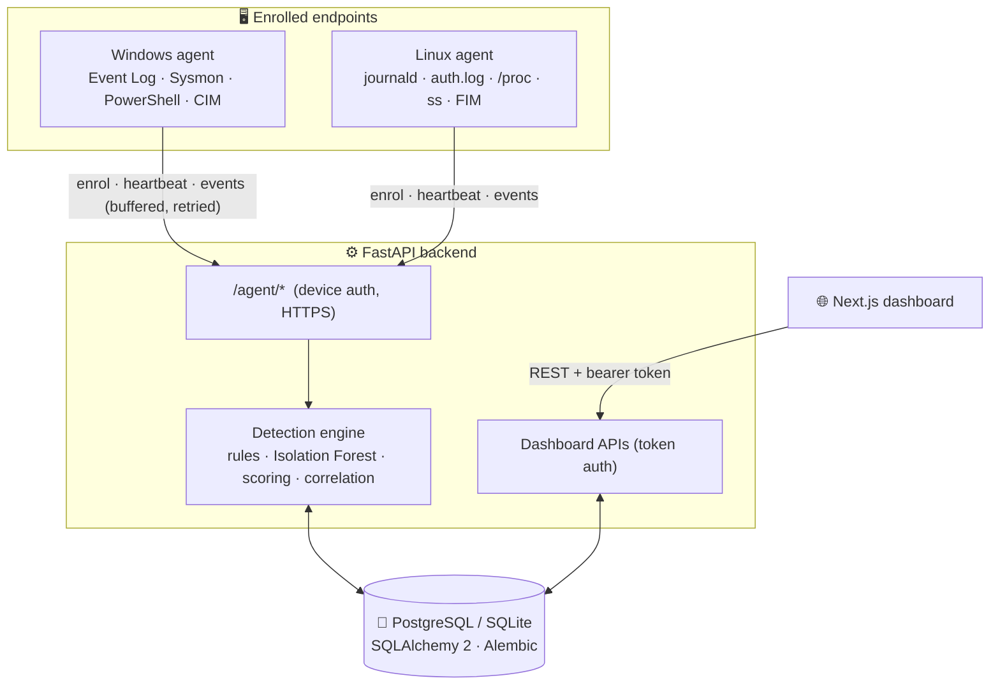

<div align="center">


# Lognexa

### AI-Driven Access Log Auditing & Cross-Platform Endpoint Monitoring

Explainable rules + Isolation Forest → risk scores, severity levels and correlated
security alerts from live Windows / Linux endpoints.

<p>
  
  
  
  
</p>
<p>
  
  
  
  
</p>
<p>
  
  
  
</p>

[Overview](#-overview) · [What's new in v2](#-whats-new-in-v2) · [Architecture](#-architecture) · [Capabilities](#-monitoring-capabilities) · [Installation](#-installation) · [Agents](#-endpoint-agents) · [API](#-api) · [Security](#-security--privacy)

</div>

---

> [!IMPORTANT]
> Lognexa is a **final-year B.E./B.Tech CSE student prototype**. It ships with
> **no demo data**: everything on the dashboard is **real telemetry** from machines
> you enrol — run it only on systems you are authorised to monitor. Detection is heuristic and **not** a replacement for
> a production EDR/SIEM. It never takes automated destructive action.

## 🔍 Overview

Lognexa's core is **cross-platform endpoint monitoring**: lightweight
**Windows and Linux agents** collect OS telemetry (authentication, process
execution, network connections, sensitive-file changes, persistence) and ship it
to the backend, which scores it, correlates related events and raises
explainable alerts on the dashboard.

The backend also keeps the original **access-log auditing** pipeline and APIs
(logins, file access, resource usage). There is no access-log collector yet, so
this module holds no data and has no dashboard page; its tests use a synthetic
fixture that lives only in the test suite.

Both use the same approach: **explainable rules** say *why* something is
suspicious, an **Isolation Forest** finds statistical outliers, and the two
combine into a **0–100 risk score** with a severity band (Low · Medium · High ·
Critical). Analysts triage alerts (acknowledge / resolve) from the dashboard.

## ✨ What's new in v2

Version 2.0.0 adds endpoint monitoring **without breaking the v1 access-log
features** — existing data and APIs are preserved through database migrations.

| | Added in v2 |
|---|---|
| 🖥️ **Endpoint agents** | Standard-library Python agents for Windows & Linux; OS-native collectors; no required third-party dependencies |
| 📡 **Local + central** | Agents run locally (view collectors with `test-collectors`) and report securely to a central backend monitoring many devices |
| 💾 **Reliable collection** | Durable SQLite buffer, retries with backoff, checkpoint recovery, server-side deduplication, auto-start services, health heartbeats |
| 🗄️ **Migrations** | Alembic migrations; a v1 database is adopted automatically and **never reset** |
| 🧠 **Endpoint detection** | 15 `EP-*` rules (brute force, suspicious commands, persistence, sensitive-file changes, log clearing, C2-like connections) + per-device Isolation Forest + **event correlation** into incidents |
| 🔐 **Security** | HTTPS-only agent transport, per-device credentials (hashed), credential rotation & revocation, role-based dashboard auth, sensitive-data redaction |
| 📊 **Dashboard** | Endpoint inventory, agent health, live events, investigation timelines, enrolment-token management, unified alert triage |
| ✅ **Tests** | 114 automated tests (81 backend + 33 agent), both OSes exercised |

## 🏗️ Architecture



Pipeline (both modules): **collect → normalise → features → rules + Isolation
Forest → risk & severity → alerts** (endpoint alerts additionally **correlate**
related events on the same host into one incident).

### Tech stack

| Layer | Technology |
|---|---|
| Agents | Python 3.9+ standard library (optional `httpx`); OS tools: `wevtutil`, PowerShell, `journalctl`, `ss`, `/proc` |
| Backend | FastAPI, Uvicorn, Pydantic v2, SQLAlchemy 2, Alembic, psycopg2 |
| Detection | pandas, NumPy, scikit-learn (Isolation Forest) |
| Database | PostgreSQL (target) / SQLite (tests & local) |
| Frontend | Next.js 16, React 19, TypeScript, Tailwind v4, shadcn/ui, Recharts, Zod |

### Repository layout

```
lognexa/
├── agent/                       # Endpoint agent (Windows + Linux)
│   ├── lognexa_agent/
│   │   ├── agent.py             # collect / send / heartbeat loops
│   │   ├── buffer.py            # durable SQLite buffer (dedup, checkpoints)
│   │   ├── client.py            # HTTPS API client
│   │   ├── redaction.py         # client-side secret redaction
│   │   ├── config.py            # config + persistent state/credential
│   │   └── collectors/          # base, windows.py, linux.py
│   ├── deploy/                  # systemd unit + Windows install script
│   └── tests/                   # 26 agent tests
├── server/
│   ├── app/
│   │   ├── models.py            # ORM (access-log + endpoint tables)
│   │   ├── security.py          # device + dashboard auth, redaction gate
│   │   ├── routers/             # logs, alerts, risk, analysis, analytics,
│   │   │                        #   agent (device-facing), endpoints (dashboard)
│   │   └── services/            # detection, endpoint_detection, endpoint_service, …
│   ├── migrations/              # Alembic (0001 baseline, 0002 endpoint)
│   ├── scripts/                 # migrate.py, init_postgres.sql
│   └── tests/                   # 81 backend tests (synthetic fixture lives here only)
├── client/                      # Next.js dashboard
└── docs/                        # full documentation
```

## 📡 Monitoring capabilities

### Access-log auditing (backend only)
Repeated/brute-force failed logins · unusual login hours · new/rare IPs &
countries · sensitive-resource access outside role. Available through the
`/logs`, `/risk-scores` and `/analyze` APIs; no data until an access-log source
is connected.

### Endpoint monitoring (real telemetry)

| Category | Windows sources | Linux sources |
|---|---|---|
| Authentication | Security log (4624/4625/4672/4740…) | journald / `/var/log/auth.log` (sshd, sudo, su) |
| Process execution | Sysmon (ID 1), Security 4688, CIM fallback | `/proc` polling (+ auditd execve via journald) |
| Network | Sysmon (ID 3) | `ss` socket diffing |
| File changes | Sysmon (ID 11) | hash-based file-integrity checks |
| Persistence | services (7045), scheduled tasks (4698), autoruns | cron / systemd unit changes |
| PowerShell | script-block logging (4104) | — |
| Defense evasion | log cleared (1102/104) | shell-history / log tampering patterns |

> Collectors report **`unsupported`**, **`permission_denied`** or **`error`**
> with a reason when a source is unavailable (e.g. the Windows Security log
> without Administrator, or Sysmon not installed) — these surface on the
> Endpoints page instead of silently collecting nothing.

**Endpoint detection rules** (`EP-*`): logon brute force, logon after repeated
failures, unusual-hour logon, failed privilege elevation, local-account creation,
privileged-group addition, suspicious command lines (encoded/hidden PowerShell,
download cradles, reverse shells, credential dumping, shadow-copy deletion, AV
tampering), execution from temp dirs, persistence creation, sensitive-file
changes, audit-log clearing, rare external connections and new listening ports.
Related events on a host within a time window are **correlated into a single
incident** with an event count.

## 📦 Installation

### Prerequisites

| Tool | Version |
|---|---|
| Python | 3.10+ (backend) / 3.9+ (agent) |
| Node.js / npm | 20+ |
| PostgreSQL | 13+ (developed with 18); SQLite works for local/dev |

> Commands below are for **Windows (PowerShell/cmd)**. On macOS/Linux use
> `.venv/bin/...` and `cp` instead of `copy`.

### 1. Database

```bash
psql -U postgres -h localhost -f server/scripts/init_postgres.sql   # edit the password first
```

### 2. Backend

```bash
cd server
python -m venv .venv
.venv\Scripts\python -m pip install -r requirements.txt
copy .env.example .env
```

Edit `server/.env`:

```ini
LOGNEXA_DATABASE_URL=postgresql+psycopg2://lognexa:<password>@localhost:5432/lognexa
LOGNEXA_CORS_ORIGINS=http://localhost:3000,http://127.0.0.1:3000
LOGNEXA_RANDOM_SEED=42

# Endpoint monitoring — generate strong random values:
#   python -c "import secrets;print(secrets.token_urlsafe(32))"
LOGNEXA_ADMIN_TOKEN=<admin token>
LOGNEXA_ANALYST_TOKEN=<analyst token>
LOGNEXA_AGENT_REQUIRE_HTTPS=true
```

> SQLite fallback: `LOGNEXA_DATABASE_URL=sqlite:///./lognexa_dev.db`. All settings
> use the `LOGNEXA_` prefix so a machine-wide `DATABASE_URL` is never picked up.

### 3. Apply migrations

```bash
.venv\Scripts\python -m scripts.migrate     # creates/upgrades schema; never deletes data
```

> `migrate` adopts a pre-existing **v1** database automatically (it stamps the
> baseline revision and upgrades) — your existing data is kept. The database
> starts empty: data arrives once you enrol an endpoint (see below).

### 4. Start the API

```bash
.venv\Scripts\python -m uvicorn app.main:app --reload --port 8000
```

Health: <http://localhost:8000/health> · API docs: <http://localhost:8000/docs>

### 5. Dashboard

```bash
cd client
copy .env.example .env.local      # NEXT_PUBLIC_API_URL=http://localhost:8000
npm install
npm run dev
```

Open <http://localhost:3000>, click **Sign in** (top bar) and paste your analyst
or admin token. Every page shows endpoint data, so it stays empty until an agent
is enrolled.

### 6. Tests

```bash
cd server && .venv\Scripts\python -m pytest          # 81 backend tests
cd agent  && python -m pytest                        # 33 agent tests
cd client && npm run lint && npm run build           # lint + production build
```

## 🖥️ Endpoint agents

The agent has **no required third-party dependencies** (standard library only;
it uses `httpx` automatically if present).

### Try collectors locally (no enrolment, nothing sent)

```bash
cd agent
set LOGNEXA_SERVER_URL=https://your-server:8000
python -m lognexa_agent.cli collectors         # list collectors + availability
python -m lognexa_agent.cli test-collectors    # run one collection cycle, print a sample
```

### Linux (systemd)

```bash
sudo useradd -r -s /usr/sbin/nologin lognexa
sudo usermod -aG systemd-journal,adm lognexa          # to read the journal / auth.log
sudo python3 -m venv /opt/lognexa-agent/venv
sudo /opt/lognexa-agent/venv/bin/pip install ./agent
sudo mkdir -p /etc/lognexa && sudo cp agent/agent.env.example /etc/lognexa/agent.env
#   edit /etc/lognexa/agent.env: set LOGNEXA_SERVER_URL and LOGNEXA_ENROLL_TOKEN
sudo cp agent/deploy/lognexa-agent.service /etc/systemd/system/
sudo systemctl daemon-reload && sudo systemctl enable --now lognexa-agent
```

### Windows (startup task, elevated PowerShell)

**Easiest — standalone release, no Python needed:** download
`LognexaAgent-<version>-windows-x64.zip` from the
[GitHub releases](https://github.com/pvtltdpratik/lognex/releases), unblock and
extract it, then double-click `install-windows.cmd` and enter your server URL and
enrolment token. The bundled `lognexa-agent.exe` (built with PyInstaller from
`agent/launcher.py`) is installed instead of a Python environment. The build is
not code-signed, so SmartScreen may ask you to confirm; verify the download
against `SHA256SUMS` on the release page.

**From a source checkout** (needs Python 3.9+ on PATH):

```powershell
cd agent\deploy
.\install-windows.ps1 -ServerUrl "https://your-server:8000" -EnrollToken "<token>"
```

Double-clicking the `.ps1` only opens it in Notepad (Windows blocks script
execution by file association). To avoid that, double-click
`install-windows.cmd` instead: it requests Administrator rights (UAC), prompts
for the server URL and token, and runs the installer with the execution policy
bypassed for that one invocation.

The installer registers a `LognexaAgent` scheduled task that runs the agent as
SYSTEM at boot and restarts it on failure. Logs go to
`C:\ProgramData\Lognexa\agent\agent.log`. Check it with
`Get-ScheduledTask LognexaAgent`, and remove it with
`Unregister-ScheduledTask LognexaAgent -Confirm:$false`.

The Windows Security event log and some collectors require **Administrator**;
without it the agent still runs and reports which collectors are unavailable.

### Enrolment

Create a one-time **enrolment token** on the dashboard (Enrolment page, admin
role) or via `POST /enrollment-tokens`. On first run the agent exchanges the token
for a **per-device credential** (`<device_uid>.<secret>`); only a SHA-256 hash of
the secret is stored server-side. The token can then be removed.

### Local and central modes
- **Local**: `test-collectors` / `status` inspect what a host would report, with no backend needed.
- **Central**: once enrolled, the agent streams to the backend, which monitors all
  enrolled devices from one dashboard.

## 🔌 API

Agent endpoints (device-authenticated, under `/agent`) and dashboard endpoints
(bearer-token authenticated). Access-log endpoints remain available unauthenticated
for backward compatibility; **endpoint data always requires a token**.

| Method | Endpoint | Auth | Description |
|---|---|---|---|
| `GET` | `/health` | — | Service + DB status, row counts, backend, version |
| `POST` | `/agent/enroll` | enrol token | Enrol a device, issue its credential |
| `POST` | `/agent/heartbeat` | device | Report agent health; receive rotation signal |
| `POST` | `/agent/events` | device | Upload a batch of telemetry (deduplicated) |
| `POST` | `/agent/rotate-credentials` | device | Exchange the credential for a new one |
| `GET` | `/auth/me` | analyst | Role of the presented token |
| `GET` | `/devices` · `/devices/{id}` | analyst | Endpoint inventory & health |
| `POST` | `/devices/{id}/revoke` · `/rotate` | admin | Revoke / request credential rotation |
| `GET`/`POST` | `/enrollment-tokens` | admin | List / create enrolment tokens |
| `GET` | `/endpoint-events` · `/endpoint-events/{id}` | analyst | Telemetry + correlated detail |
| `GET` | `/endpoint/overview` | analyst | Endpoint dashboard statistics |
| `GET`/`PATCH` | `/alerts` · `/alerts/{id}` | mixed | Alert list, detail and triage (endpoint alerts need a token) |
| `GET` | `/logs`, `/risk-scores`, `/analytics/overview` | — | Access-log auditing (v1; backend only) |
| `POST` | `/analyze` | — | Run access-log analysis (409 `no_data` until access logs exist) |

Errors use one envelope: `{"error":{"code","message","details"}}`. Full
reference: [`docs/api-reference.md`](docs/api-reference.md).

## 🔐 Security & privacy

- **Transport**: agents must use HTTPS (loopback exempted for dev); `TRUST_PROXY_HEADERS` for a TLS-terminating proxy.
- **Device identity**: per-device credential; only a SHA-256 hash is stored; rotation and revocation supported.
- **Dashboard auth**: analyst / admin bearer tokens; least-privilege (token management & credential actions are admin-only); endpoint telemetry is never exposed without a token.
- **Redaction**: secrets (passwords, keys, tokens, connection strings, private keys) are stripped **on the agent before buffering** and again **on the server before storage** (defence in depth).
- **Input validation**: every agent and dashboard payload is validated by Pydantic (bounded sizes, patterns, enums, rejected unknown fields).
- **No destructive response**: Lognexa only observes, scores and alerts.

## 🧠 Detection notes

```
risk = w × rule_score + (1 − w) × ml_score + 10 (if a rule fired AND the forest flagged it)   # w = 0.6
```
Severity: Critical ≥ 75 · High ≥ 50 · Medium ≥ 25 · Low < 25. When a device has
fewer than 50 events in the look-back window the Isolation Forest is not fitted
and endpoint risk falls back to the pure rule score, so a strong single indicator
still alerts. The access-log pipeline, evaluated in the test suite on a
synthetic fixture with injected labels (threshold 40): precision **0.78**,
recall **0.96**, F1 **0.86** — not an estimate of real-world accuracy. See
[`docs/ml-methodology.md`](docs/ml-methodology.md).

## 🧪 Testing

| Suite | Count | Covers |
|---|---|---|
| Backend (`server/tests`) | 81 | Access-log detection (synthetic test fixture), endpoint detection (both OSes), endpoint API (enrol/auth/ingest/dedup/redaction/rotation/revocation), migrations (incl. v1 adoption), API security |
| Agent (`agent/tests`) | 33 | Durable buffer (persistence, dedup, bounded size), redaction, event identity, collector availability per platform, HTTPS enforcement, BOM-tolerant config, log file, Windows timestamp precision, schema fitting, poison-event isolation |
| Frontend | — | `tsc`, ESLint, production build (6 routes) |

End-to-end flows were also verified live on this machine (Windows collectors) and
in Ubuntu WSL (Linux collectors). See [`docs/testing.md`](docs/testing.md).

## 🛠️ Troubleshooting

| Symptom | Fix |
|---|---|
| Endpoint pages say "Sign in required" | Click **Sign in**, paste an analyst/admin token (server `LOGNEXA_*_TOKEN`) |
| `/devices` → `503 auth_not_configured` | Set `LOGNEXA_ADMIN_TOKEN` / `LOGNEXA_ANALYST_TOKEN` and restart the API |
| Agent: "Refusing to use plain HTTP" | Use an `https://` server URL, or `insecure_http_ok` for a localhost dev server |
| Windows Security collector `permission_denied` | Run the agent as Administrator |
| Agent log shows `server rejected event` | The event is saved to `rejected.jsonl` in the agent data folder; the rest of the batch is still delivered |
| Linux `linux_auth` can't read the journal | Add the agent user to the `systemd-journal` group |
| Dashboard "Backend unavailable" | Start the API on port 8000; check `NEXT_PUBLIC_API_URL` |

## ⚠️ Limitations

- No access-log collector yet: that pipeline is only exercised against a synthetic test fixture.
- Endpoint detection is heuristic (rules + unsupervised ML), not a full EDR; some collectors need elevated privilege or Sysmon.
- Analysis is batch, not streaming; per-device baselines use a look-back window.
- Dashboard auth is static bearer tokens (no per-user accounts/SSO).
- `top_features` / correlation are heuristics, not formal attribution.

## 🛣️ Future improvements

- Per-user dashboard accounts & SSO; signed agent packages & auto-update.
- Streaming detection; richer correlation (process-tree graphs).
- More collectors (auditd rules, eBPF, macOS); threat-intel / geo-IP enrichment.
- SHAP explanations; alert-feedback loop to tune weights.

## 👤 Author

**Pratik Kolhe** — final-year B.E./B.Tech Computer Science & Engineering project.

<div align="center">
<sub>FastAPI · scikit-learn · PostgreSQL · Next.js · Windows & Linux agents · For academic use</sub>
</div>
