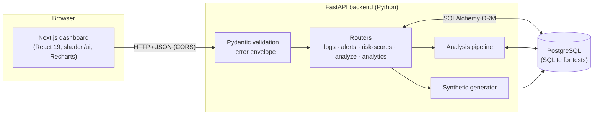
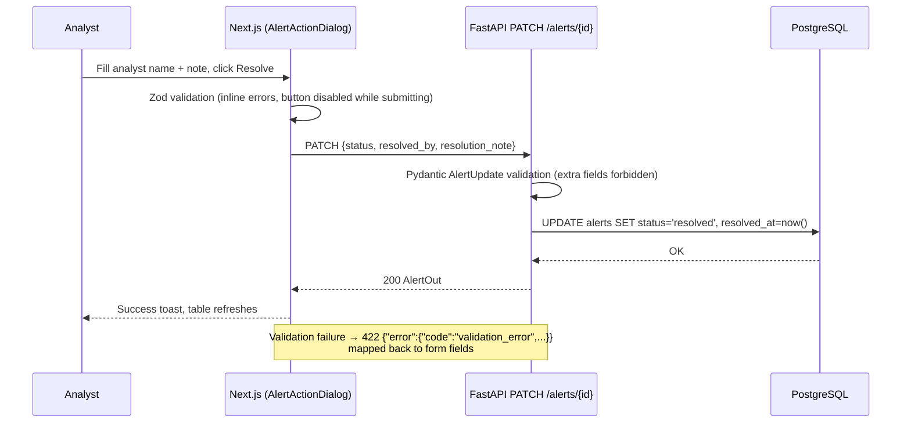

# System Architecture

## High-level architecture

Lognexa is a three-tier web application.



| Tier | Technology | Responsibility |
|---|---|---|
| Presentation | Next.js 16 (App Router), TypeScript, Tailwind CSS v4, shadcn/ui (Base UI), Recharts, Zod, react-hook-form | Dashboard pages, client-side validation, charts, triage forms |
| Application | FastAPI, Uvicorn, Pydantic v2 | REST endpoints, validation, error handling, orchestration |
| Analytics | pandas, NumPy, scikit-learn | Feature engineering, rules, Isolation Forest, scoring, evaluation |
| Data | PostgreSQL via SQLAlchemy 2 + psycopg2 | Persistent storage of users, logs, scores, alerts, runs |

## Analysis pipeline (data flow)

```mermaid
flowchart TD
    A[access_logs + users] -->|load_log_frame| B[pandas DataFrame]
    B --> C[build_features<br/>10 behavioural features per event]
    C --> D[apply_rules<br/>11 explainable rules → rule_score]
    C --> E[Isolation Forest<br/>→ ml_score, ml_is_anomaly]
    D --> F[combine_scores<br/>risk = w·rule + (1−w)·ml + bonus]
    E --> F
    F --> G[classify → severity]
    F --> H[explain + top_feature_deviations]
    G --> I[(risk_scores)]
    H --> I
    G -->|risk ≥ threshold| J[(alerts)]
    I --> K[evaluation_metrics<br/>vs injected labels]
    K --> L[(analysis_runs.metrics)]
```

Code: `server/app/services/pipeline.py` (`run_analysis`, `score_frame`).

Steps on every `POST /analyze`:

1. Insert an `analysis_runs` row with status `running`.
2. Load every log joined with the user's role.
3. Compute features, rule scores and ML scores in memory.
4. Replace all `risk_scores` rows.
5. Delete **open** alerts, keep acknowledged/resolved ones (analyst history),
   create alerts for events with `risk ≥ alert_threshold` that do not already
   have one.
6. Store evaluation metrics and mark the run `completed` (or `failed`, with the
   error message, after a rollback).

## Request flow example: resolving an alert



## Frontend structure

| Route | File | Purpose |
|---|---|---|
| `/` | `client/app/page.tsx` | KPI cards, daily activity/alerts chart, severity distribution, hourly histogram, rule hits, top users, latest run |
| `/logs` | `client/app/logs/page.tsx` | Search + 7 filters, sorting, pagination, event detail sheet |
| `/alerts` | `client/app/alerts/page.tsx` | Status tabs, search/severity/sort, alert detail sheet, acknowledge/resolve/reopen |
| `/risk` | `client/app/risk/page.tsx` | Methodology (formula, bands, rules), scored-event table, user ranking |
| `/analysis` | `client/app/analysis/page.tsx` | Run-analysis form, regenerate-dataset form, evaluation metrics, run history |

Shared pieces: `components/app-shell.tsx` (sidebar, header, API health
indicator, theme toggle), `components/risk-explanation.tsx`,
`components/log-detail-sheet.tsx`, `components/alert-action-dialog.tsx`,
`hooks/use-api.ts`, `lib/api.ts`.

All pages are client components that fetch from the API at runtime, so the
dashboard always shows current database contents. No statistics are hard-coded.

## Design system

- **Brand**: the existing `logo.jpg` (red eye-in-card with circuit traces) was
  redrawn as an SVG mark (`components/brand/logo.tsx`).
- **Palette** ("Sentinel"): near-black surfaces with a single signal-red primary,
  defined as OKLCH CSS variables in `client/app/globals.css` for light and dark
  modes; dark is the default. Separate tokens `--severity-low/medium/high/critical`
  and `--success` keep risk levels readable in both themes.
- **Typography**: Space Grotesk (headings), IBM Plex Sans (UI text), JetBrains
  Mono (IPs, timestamps, paths).
- **Components**: the pre-installed shadcn/ui `base-sera` style components are
  used as-is (Card, Table, Sheet, Dialog, AlertDialog, Tabs, Field, NativeSelect,
  InputGroup, Pagination, Chart, Toast, Sidebar, Skeleton, Empty, Alert, Spinner…).

## Error handling strategy

| Layer | Mechanism |
|---|---|
| API input | Pydantic / FastAPI validation → `422 validation_error` with per-field details |
| Business rules | `APIError` → `404 not_found`, `409 no_change`, `409 no_data`, `422 analysis_failed` |
| Database | `SQLAlchemyError` handler → `503 database_error` (details only in server log) |
| Unexpected | Catch-all → `500 internal_error` |
| Startup | DB init failure is logged; API stays up so `/health` reports `degraded` |
| Frontend | `ApiError` class; network failures show "Backend unavailable" with Retry; empty datasets show empty states; skeletons while loading |
