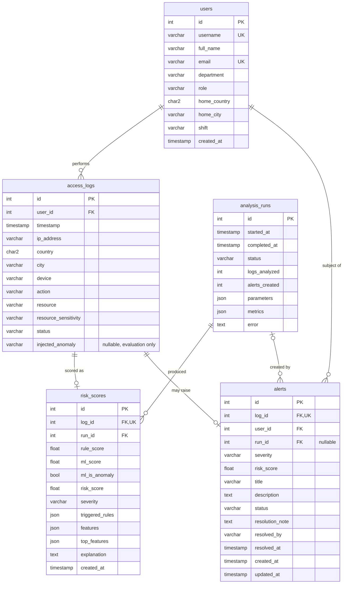

# Database Schema

Defined in `server/app/models.py` (SQLAlchemy 2 declarative models). Tables are
created automatically on API start-up and by `scripts/seed.py`
(`Base.metadata.create_all`). Only portable column types are used, so the same
schema runs on PostgreSQL (target) and SQLite (tests / local fallback). JSON
columns map to `json` on PostgreSQL.

## Entity-relationship diagram

## Tables

### `users`
Synthetic employees (60 by default).

| Column | Type | Notes |
|---|---|---|
| id | integer PK | |
| username | varchar(64) unique, indexed | e.g. `nverma` |
| full_name | varchar(120) | |
| email | varchar(160) unique | `@lognexa-demo.test` (reserved test domain) |
| department | varchar(64) indexed | Engineering, Finance, Human Resources, Sales, Operations, IT Security |
| role | varchar(64) | developer, financial_analyst, hr_specialist, sales_executive, sysops, it_admin |
| home_country / home_city | varchar | All users are based in India (IN) |
| shift | varchar(16) | `day` or `night` (a third of Operations staff) |
| created_at | timestamp | server default `now()` |

### `access_logs`
One row per access event (2,200 by default).

| Column | Type | Notes |
|---|---|---|
| id | integer PK | |
| user_id | FK → users.id, `ON DELETE CASCADE`, indexed | |
| timestamp | timestamp, indexed | Naive timestamps in local office time |
| ip_address | varchar(45) | Only RFC 1918 / RFC 5737 documentation ranges |
| country, city | varchar | Generated, not geo-resolved |
| device | varchar(64) | e.g. `Windows 11 / Chrome`, `Linux / curl` |
| action | varchar(32), indexed | login, logout, file_read, file_write, download, admin_action |
| resource | varchar(160) | e.g. `/finance/payroll`, `/auth/sso` |
| resource_sensitivity | varchar(16), indexed | public, internal, confidential, restricted |
| status | varchar(16), indexed | success, failure, denied |
| injected_anomaly | varchar(32), nullable | Ground-truth label from the generator. **Never used as a detection input**; only for evaluation |

Composite index `ix_access_logs_user_ts (user_id, timestamp)` supports per-user
time-ordered queries.

### `risk_scores`
One row per log for the latest analysis run (replaced on each run).

| Column | Type | Notes |
|---|---|---|
| log_id | FK → access_logs.id, unique | 1 : 1 with a log |
| run_id | FK → analysis_runs.id | |
| rule_score | float 0–100 | Sum of rule points, capped |
| ml_score | float 0–100 | Rescaled Isolation Forest score |
| ml_is_anomaly | boolean | Forest prediction == −1 |
| risk_score | float 0–100, indexed | Combined score |
| severity | varchar(16), indexed | low / medium / high / critical |
| triggered_rules | JSON list | `[{code, name, category, points, reason}]` |
| features | JSON object | Feature values used (plus `rule_weight` of the run) |
| top_features | JSON list | `[{feature, label, value, z_score}]` – explainability heuristic |
| explanation | text | Human-readable summary |

### `alerts`
Raised for events with `risk_score ≥ alert_threshold` (default 40).

| Column | Type | Notes |
|---|---|---|
| log_id | FK → access_logs.id, unique | At most one alert per event |
| user_id | FK → users.id | Denormalised for fast per-user queries |
| run_id | FK → analysis_runs.id, `SET NULL` | Run that created it |
| severity, risk_score | snapshot at creation | |
| title, description | text | Derived from the highest-weighted rule category |
| status | varchar(16), indexed | open, acknowledged, resolved |
| resolution_note, resolved_by, resolved_at | nullable | Required when resolving (validated by the API) |
| created_at, updated_at | timestamp | |

### `analysis_runs`
Audit trail of every analysis.

| Column | Type | Notes |
|---|---|---|
| status | varchar(16) | running, completed, failed |
| parameters | JSON | contamination, alert_threshold, rule_weight, seed |
| metrics | JSON | precision/recall/F1 (combined, rules-only, ML-only), per-type recall, caveat |
| error | text | Populated when a run fails |

## Re-analysis semantics

- `risk_scores` are fully replaced.
- Alerts with status `open` are deleted and regenerated; `acknowledged` and
  `resolved` alerts are **kept**, so analyst work survives a re-run.
- `POST /dataset/generate` deletes all tables' rows (demo data only) before
  loading a new dataset.

## PostgreSQL setup

See `server/scripts/init_postgres.sql` and
[setup-and-deployment.md](setup-and-deployment.md).
